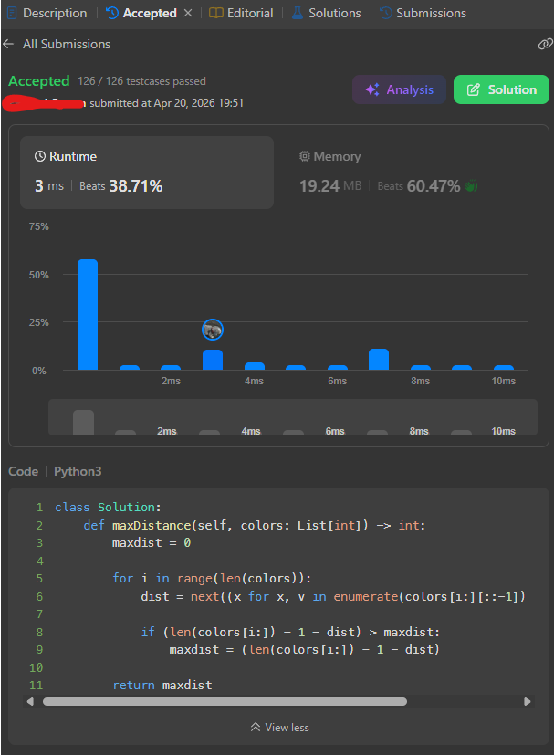
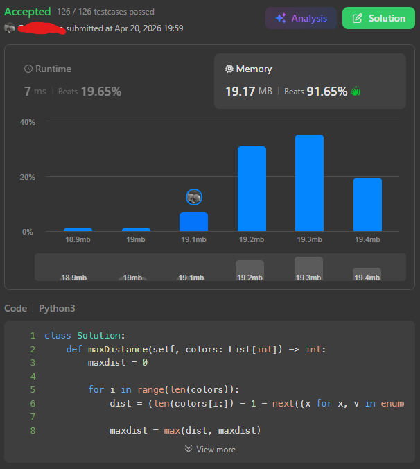
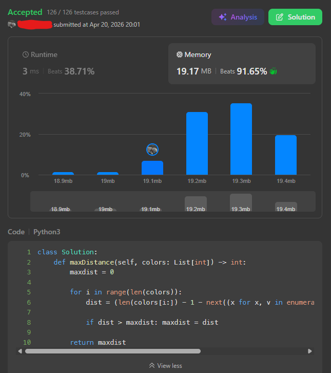

# 04/20/2026 - Two Furthest Houses With Different Colors (Easy)

## First Thoughts
At a first glance, a fancy type of sliding window seems like it might be the best call to impliment this.

My general thoughts is something like the following:

[1, 4, 6, 8, 1, 2, 4] -> (1) | [4, 6, 8, 1, 2, 4] where we can then find the first occuring index of any number that is NOT the one that we picked out of the list (in this case, 1) and that will be our length. If there is no occurence, then that number is effectively repeated for the rest of the list (or is the end of the list) and is effectively 0. We can then shift rightward through each number (this might be slow, but maybe I'll come up with a way to optimize it) and determine a maximum.

## Attempt One (Solving)

```py
def maxDistance(self, colors: List[int]) -> int:
    maxdist = 0

    for i in range(len(colors)):
        dist = next((x for x, v in enumerate(colors[i:]) if v != colors[i]), 0)
        if dist > maxdist:
            maxdist = dist

    return maxdist
```

This worked for the `colors = [1,1,1,6,1,1,1]`, but has trouble on the `colors = [1,8,3,8,3]` test because it hits the first non-equal number then stops. We need to reverse the list we are checking against so that we can pull from the maximum / far side.

```py
def maxDistance(self, colors: List[int]) -> int:
    maxdist = 0

    for i in range(len(colors)):
        dist = next((x for x, v in enumerate(colors[i:][::-1]) if v != colors[i]), 0)
        
        if (len(colors[i:]) - 1 - dist) > maxdist:
            maxdist = (len(colors[i:]) - 1 - dist)

    return maxdist
```

This works correctly for all test cases given in the problem's description! We don't need to worry about empty or 1-length lists because of the questions constraints, and since there are <= 100 items we shouldn't time out with the implimentation.

And it did pass the submission tests! It runs a tad on the slower end (not even top 60%), but on the other hand memory usage was pretty low at 19.24MB which was top 40%! I can work to optimize it a tad regardless by removing some varaiables and calculations.



## Attempt Two (Optimizing)
```py
def maxDistance(self, colors: List[int]) -> int:
    maxdist = 0

    for i in range(len(colors)):
        dist = (len(colors[i:]) - 1 - next((x for x, v in enumerate(colors[i:][::-1]) if v != colors[i]), 0))
        
        maxdist = max(dist, maxdist)

    return maxdist
```

This cut down on memory usage quite a bit (down to 19.17MB, top 9%), but it was WAY slower. I tried to skip an if statement with the max() call but I'm assuming it is slower somehow, bringing back the if-then brings the time down from 7ms to 3ms. `colors[i:][::-1]` is probably what is making this whole thing take a decent bit of time, but regardless I am satisfied with this solution and it scores pretty highly.

With max()                 | Without max()
:-------------------------:|:-------------------------:
 | 

## Final results:
- Tests: 126/126 passed
- Runtime: 3MS (beats 38.71%)
- Memory: 19.17MB (beats 91.65%)

### Final Code
```py
class Solution:
    def maxDistance(self, colors: List[int]) -> int:
        maxdist = 0

        for i in range(len(colors)):
            dist = (len(colors[i:]) - 1 - next((x for x, v in enumerate(colors[i:][::-1]) if v != colors[i]), 0))
            
            if dist > maxdist: maxdist = dist

        return maxdist
```