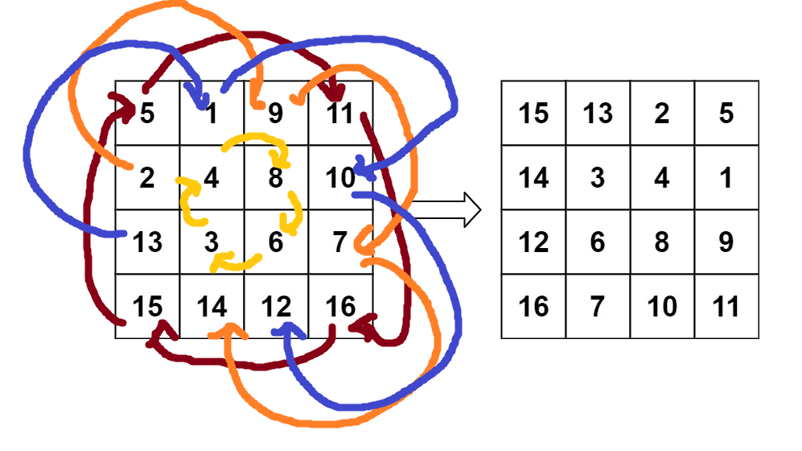
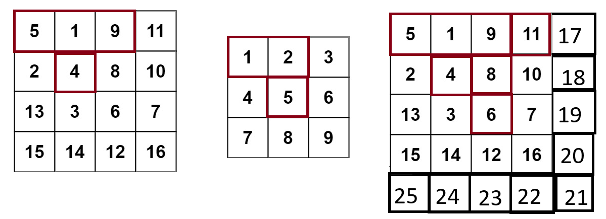
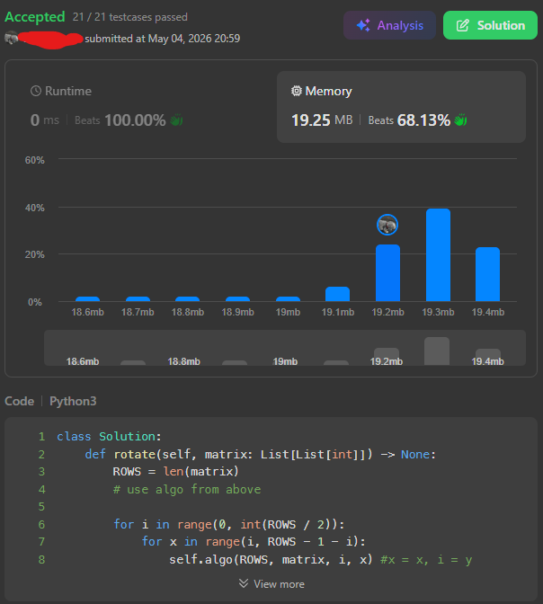

# 05/04/2026 - Rotate Image (Medium)

## First Thoughts
This looks easy enough, we are given data for each individual row and all we have to do is transition those rows to be the columns. If we could make a new list this would be super super easy, but it says we cant so we need to figure out some other way (probably some shenanigans with reversing and moving items around the lists).

To start things off I made a few mockups but this was the first one that stuck for me. It shows the rotation locations of every piece and picks up a chain where each number can rotate and hit in a loop. Different colors correspond to different loops from rotation


From this mockup I was able to pick out some equations to determine the rotation position of each item relative to a rotation starting block (for me its the upper leftmost in each chain). I marked the first block's position as (X,Y) and got three rotation equations from there.

If you have [A,B,C,D] in a chain you can swap like so to "rotate" them in place:
`[A,B,C,D] -> [B,A,C,D] -> [C,A,B,D] -> [D,A,B,C]`.
In basic terms this gives you a final rotated and shifted list of the four boxes, but we have to figure out how to do it in 2D. The equations I found are below:

- First swap: 
`(X,Y) -> (ROWS-1-Y, X)`

- Second swap:
`(X,Y) (since the second number is now in the first slot) -> (ROWS-1-X, ROWS-1-Y)`

- Third swap:
`(X,Y) (same as before, third number is now in first slot) -> (Y , ROWS-1-X)`

In my head this *seems*(?) to rotate everything correctly. Now I just need to figure out the range to loop through.


Since each loop covers 4 keys we should be able to find the amount of total loops for each list using `loops=int((X^2)/4)` (for evens), or `loops=int((X^2)/4) + 1` (for odds)

Drawing it out the blocks we loop from should be positioned so they they don't overlap while rotating, looking something like this (where the boxes in red are the ones being rotated for each respective grid size):



Based on some stunning mental math I think that we shoud loop through like the following:
```py
ROWS = len(matrix)
if ROWS % 2 == 0: #even row counts
    for i in range(0, ROWS / 2): # each row / layer
        for x in range(i, ROWS - 1 - i): # each item in that row (following the pyramic-esque pattern we see)
            # run our rotate algo here for each item
else: # odd row counts
    #...
    continue
```
And that should hit every one that we need.

## Attempt One (Solving)
```py
class Solution:
    def rotate(self, matrix: List[List[int]]) -> None:
        ROWS = len(matrix)
        # use algo from above
        
        for i in range(0, int(ROWS / 2)):
            for x in range(i, ROWS - 1 - i):
                self.algo(ROWS, matrix, i, x) #x = x, i = y
        # since the middle piece in an odd-row case is just going to be itself we can ignore rotating it

        # this places our final list backwards, and so we need to reverse it for the final answer
        for x in matrix:
            x.reverse()
        matrix.reverse()

    def algo(self, ROWS, matrix, y, x):
        # use rotation algo from first thoughts
        #First swap:
        #(X,Y) -> (ROWS-1-Y, X)
        matrix[x][y], matrix[ROWS-1-y][x] = matrix[ROWS-1-y][x], matrix[x][y]
        #Second swap:
        #(X,Y) (since the second number is now in the first slot) -> (ROWS-1-X, ROWS-1-Y)
        matrix[x][y], matrix[ROWS-1-x][ROWS-1-y] = matrix[ROWS-1-x][ROWS-1-y], matrix[x][y]
        #Third swap:
        #(X,Y) (same as before, third number is now in first slot) -> (Y , ROWS-1-X)
        matrix[x][y], matrix[y][ROWS-1-x] = matrix[y][ROWS-1-x], matrix[x][y]
```
Using the formulas from my first thoughts I actually got this working almost perfectly on the first try! However the final answers came out like `[[6,5,4],[3,2,1]]` instead of `[[[1,2,3],[4,5,6]]` and so adding a few lines to reverse the inner and outer list got the solutions all accepted on the second try! For how spread out and one-shotted this code was, it ran supprisingly well! It actually beat 100.00% for runtime and used 19.25MB of memory, beating 68.13%.



## Beautifying
There is next to no memory left to save, and the speed is already really good, everything left to gain is basically just due to leetcode's standard memory variation from running, it just bumps around every once in a while. I'll clean up the code and make it look pretty. *Technically* you could save a couple bytes by removing the ROWS variable but that would make the code very ugly with tons of len(matrix) calls, and just isn't worth it in my opinion.

```py
class Solution:
    def rotate(self, matrix: List[List[int]]) -> None:
        ROWS = len(matrix)
        
        for i in range(0, int(ROWS / 2)):
            for x in range(i, ROWS - 1 - i):
                #First swap: (X,Y) -> (ROWS-1-Y, X)
                matrix[x][i], matrix[ROWS-1-i][x] = matrix[ROWS-1-i][x], matrix[x][i]
                #Second swap: (X,Y) -> (ROWS-1-X, ROWS-1-Y)
                matrix[x][i], matrix[ROWS-1-x][ROWS-1-i] = matrix[ROWS-1-x][ROWS-1-i], matrix[x][i]
                #Third swap: (X,Y) -> (Y , ROWS-1-X)
                matrix[x][i], matrix[i][ROWS-1-x] = matrix[i][ROWS-1-x], matrix[x][i]

        # reverse final output
        for x in matrix:
            x.reverse()
        matrix.reverse()
```
This final run pulled 0ms runtime (beats 100%), and 19.21MB memory (beats 68.13%).

## Final results:
- Tests: 21/21 passed
- Runtime: 0ms (beats 100.00%)
- Memory: 19.21MB (beats 68.13%)